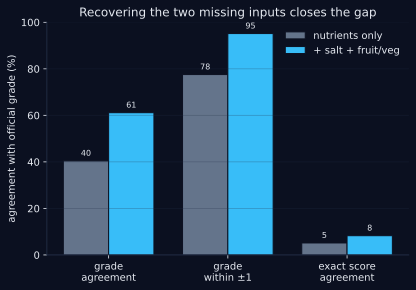
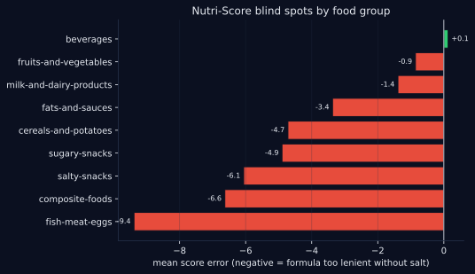

# 🥗 Open Food Facts — Rebuilding the Nutri-Score, salt included

[](https://github.com/boumbo85/p3-nutrition-openfoodfacts-eda/actions/workflows/ci.yml)
[](https://www.python.org/)


> **The result:** reconstructing the official Nutri-Score from raw nutrients lands **40%** of products on the exact grade. Recovering the two inputs a naïve reconstruction ignores — **salt** and the **fruit/vegetable %** — pushes the match to **95% within one grade** and cuts the systematic bias from **−4.83 to −1.68 points**. The gap between those two numbers *is* the measured weight of salt and produce in the formula. The remaining **−1.68** is left honestly unattributed: part of it is the 2017↔2023 formula change the data cannot separate from the missing inputs (see §4).
>
> Built on a biochemically-cleaned extract of the **French Open Food Facts** catalogue (2026 snapshot): **956,514 products → 880,087 kept**, with only **0.75 %** removed for breaking a physical law (the rest are empty crowdsourced records).

**Stack:** `duckdb` · `pandas` · `numpy` · `matplotlib` · `streamlit` · `Python` | **Status:** completed | **Data vintage:** 2026 (single snapshot) · origins 2022, see §11

> 🇫🇷 *Version française plus bas — [aller à la version FR](#-version-française).*



---

## 1. The one-sentence sell

The Nutri-Score is a public formula, so "predicting" it is trivial. The real question is **which inputs actually carry it** — and what happens to a reconstruction that is missing some. Rebuild it from nutrients alone and it runs **−4.83 points too lenient**; add salt and the fruit/vegetable % and the bias collapses to **−1.68**, with **95% of grades landing within one** of the official one. Knowing *which* inputs close the gap is a domain question, not a modelling one.

## 2. Two-step reconstruction — the headline result

The dataset ships the **official** Nutri-Score (`nutriscore_score`/`nutriscore_grade`) as ground truth. We re-implement the public point grid and compare, in two deliberate steps, on the **457,745** clean products that carry an official score.

| Metric | Step 1 — nutrients only | Step 2 — + salt + fruit/veg | Shift |
|---|---|---|---|
| Signed bias (points) | **−4.83** | **−1.68** | ÷ 2.9 |
| Mean absolute error | 6.40 | **3.54** | −45 % |
| Exact grade agreement | 40.4 % | **61.1 %** | +20.7 pts |
| **Grade within ±1** | 77.5 % | **95.1 %** | +17.6 pts |

**Reading it:** nutrients-only is systematically *too kind* because it never sees the salt penalty. Feed salt back in (sodium = salt ÷ 2.5) and the fruit/vegetable bonus, and the reconstruction snaps onto the official grade. The −4.83 → −1.68 move is the formula telling you exactly how much those two inputs are worth.

## 3. Where nutrients-only goes wrong (the blind-spot map)

The residual error of the nutrients-only score is not noise — it maps cleanly onto the foods whose missing inputs matter most:



- **Fish/meat/eggs −9.38**, salty snacks −6.06, composite foods −6.63: judged far too kindly without the salt penalty.
- **Fruits & vegetables −0.86**, beverages +0.13: barely affected (little salt, and the produce bonus is what they were missing).

A biologist's reading: the score leans on sodium for exactly the foods where sodium is the health signal. Remove it and you flatter cured meat; restore it and the ranking recovers.

## 4. Honest scope of the match (non-negotiable)

The 95 %-within-one is real, but it is earned on the rows that *carry* the recovered inputs — stated plainly rather than rounded up:

- **Salt / sodium:** filled on **92 %** of the clean extract — nearly universal, so the salt correction applies almost everywhere.
- **Fruit/vegetable %:** filled on only **37 %**. For the other 63 % the bonus defaults to 0, which keeps a slice of the residual bias. This is a data-coverage limit, not a modelling one.
- **A second, unfixable cause of residual error:** Open Food Facts has migrated to the **2023 Nutri-Score algorithm**, while this reconstruction implements the **2017** grid. This dump carries no per-product version flag, so part of the leftover −1.68 is the 2017↔2023 formula change, which we cannot separate from the inputs. We therefore **do not** claim the whole residual comes from missing inputs.
- **Exact-score agreement stays low (8 %)** for the same reason — exact points are brittle across algorithm versions; grade-within-one is the honest headline.

## 5. The biochemical cleaning — what makes the extract trustworthy

Before any of that, the catalogue has to be worth scoring. The cleaning is driven by **biochemistry**, not just column bounds — the physical laws a real food must obey become the filters. This is the part a generic pipeline skips; it comes straight from a molecular-biology background.

- **Subset hierarchies.** Saturated fat ≤ total fat; sugars ≤ carbohydrates. → **585** sat-fat and **761** sugar violations.
- **Mass balance.** fat + carbohydrate + (fibre) + protein ≤ 100 g/100g; the rest is water, salt, ash. → **2,909** impossible rows (+1 g tolerance for label rounding).
- **Atwater energy floor.** Each macro has a minimum energy density (fat 37, carb/protein 17, fibre 8 kJ/g), so declared energy can't fall far below the composition's. → **2,937** rows physically too low.
- **kcal↔kJ unit errors.** Energy logged in kcal reads ~4.18× too low — caught when it matches Atwater/4.184. → **1,894** correctable mix-ups (flagged, not deleted).

### The headline rate, told honestly

| What | Count | Share of 956,514 |
|---|---|---|
| **Physical-law violations** (biochemistry) | 7,154 | **0.75 % [0.73–0.77]** |
| Empty "ghost" records (0 everywhere) | 64,713 | 6.8 % |
| Unusable product names | 6,429 | 0.7 % |
| **Total removed** | 76,427 | **7.99 % [7.94–8.04]** |

The **0.75 %** is the number that means something: products that *look* fine column-by-column yet break a physical law. The 8 % headline is dominated by empty crowdsourced records — reported, but not dressed up as biochemistry. Both rates come with a **bootstrap 95 % CI** (1,000 resamples, fixed seed): the intervals are ±0.05 pt wide on ~956k products, so the result is insensitive to the exact expert thresholds — the usual reviewer objection, closed.

## 6. Does the food group drive nutrition? (statistical tests)

On the **460,831** products carrying a food group: one-way **ANOVA** shows the group explains **61 % of the variance in carbohydrates, 53 % in sugars, 47 % in protein** (η²), far less for fibre (16 %). **χ²** links the Nutri-Score grade to the group (Cramér's V = **0.34**) — moderate: category matters, but isn't destiny. Every test reports an effect size next to the p-value (with n ≈ 460k, significance is automatic; the effect size is what means something). Implemented in pure numpy/pandas — F and χ² tail probabilities included, no scipy.

## 7. Interactive demo

`app/streamlit_app.py` — pick a product and see its **official vs reconstructed grade**, the **points breakdown** (now including the salt penalty and produce bonus), and a **healthier alternative** from the same category.

```bash
streamlit run app/streamlit_app.py
```

## 8. Limits & critical review

- **Thresholds are expert choices**, now backed by bootstrap CIs (§5) rather than a single point value — but not by a formal cross-validation of each cut-off.
- **Fruit/veg % is only 37 % filled** (§4): the reconstruction's produce bonus is absent for most products, capping the achievable agreement.
- **2017 vs 2023 algorithm** (§4): part of the residual bias is the formula change, inseparable without a per-product version.
- **Alcoholic beverages** keep the solid-food grid (Nutri-Score treats them apart); a small, documented approximation.
- **Statistical tests cover the ~48 %** of products with a food group; they don't generalise to the uncategorised rest.
- Crowdsourced data skews toward **processed, branded products**.

## 9. Conclusion

A reconstruction that doesn't stop at "the formula is predictable". By asking **which inputs carry it**, the project turns a trivial re-score into a measurement: salt and the fruit/vegetable % are worth ~3 points of bias and 18 points of grade agreement. Underneath, biochemistry — not column bounds — decides which products are trustworthy enough to score, catching the 0.75 % that break a physical law while being honest that the bulk of removed rows are empty records. Rigour, not a flattering headline, is the point.

---

## 🗂️ Repository structure

```
p3-nutrition-openfoodfacts-eda/
├── src/
│   ├── build_dataset.py    # DuckDB: official 2026 parquet → FR flat extract (+ salt, fruit/veg)
│   ├── eda.py              # cleaning + biochemical checks + bootstrap CI (pure, no scipy)
│   ├── run_eda.py          # reproducible EDA → dark SVG figures + results.json
│   ├── nutriscore.py       # Nutri-Score reconstruction (nutrients-only AND full) + validation
│   ├── run_nutriscore.py   # two-step validation → figures + results_nutriscore.json
│   └── make_clean_extract.py  # physically-clean extract + audit report (+ bootstrap)
├── app/
│   └── streamlit_app.py    # interactive demo
├── tests/                  # pytest — cleaning, biochemistry, Nutri-Score (45 tests)
├── data/README.md          # source + license (data not versioned)
└── docs/figures/           # dark SVG charts
```

## ▶️ Reproduce

Every number in this README is regenerated into `results*.json` by the scripts below — no figure is hand-typed.

```bash
python -m venv .venv && source .venv/bin/activate
pip install -r requirements.txt

# 1. Build the French extract from the official parquet dump (see data/README.md)
python src/build_dataset.py --source data/food.parquet --out data/off_fr_2026.csv

# 2. Biochemical cleaning + audit (writes results_physical_audit.json)
python src/make_clean_extract.py --data data/off_fr_2026.csv \
    --out data/physically_clean_2026.csv --report results_physical_audit.json

# 3. EDA + stats + figures (writes results.json)
python src/run_eda.py --data data/physically_clean_2026.csv --out docs/figures --results results.json

# 4. Two-step Nutri-Score validation + figures (writes results_nutriscore.json)
python src/run_nutriscore.py --data data/physically_clean_2026.csv \
    --out docs/figures --results results_nutriscore.json

streamlit run app/streamlit_app.py
```

## 🧪 Dev / tests

```bash
pip install -r requirements-dev.txt
ruff check src tests app
pytest -q          # 45 tests on pure logic, no dataset needed
```

## 📦 Data

**[Open Food Facts](https://world.openfoodfacts.org/data)** — collaborative, free food database, License **[ODbL 1.0](https://opendatacommons.org/licenses/odbl/1-0/)**. The 2026 parquet dump (~8 GB) and the derived extracts are **not** versioned — see [`data/README.md`](data/README.md).

## 11. Why a 2026 single-vintage rebuild

The original 2022 extract predates the salt and fruit/vegetable columns needed to fully reconstruct the score, and Open Food Facts keeps **no dated historical dump** ([OFF support](https://support.openfoodfacts.org/help/fr-fr/12-donnees-api/105-comment-puis-je-acceder-aux-donnees-historiques)). Grafting today's salt onto 2022 composition would mix two record versions — a temporal leak. So this rebuild starts from a **single current snapshot**: composition, salt, fruit/veg % and official score all come from the same 2026 vintage, making the enrichment leak-free by construction. The frozen 2022 version lives at tag `v1.0-2022-biochem`.

---

# 🇫🇷 Version française

> **Le résultat :** reconstruire le Nutri-Score officiel à partir des seuls nutriments place **40 %** des produits sur le grade exact. En récupérant les deux entrées qu'une reconstruction naïve ignore — le **sel** et le **% fruits/légumes** — on atteint **95 % à un grade près** et le biais systématique tombe de **−4,83 à −1,68 point**. L'écart entre ces deux chiffres *est* le poids mesuré du sel et des fruits/légumes dans la formule. Le **−1,68** restant n'est **pas** imputé aux seules données manquantes : une partie est le changement de barème 2017↔2023, que la donnée ne permet pas de séparer (voir §4).
>
> Le tout sur un extrait d'Open Food Facts **France** nettoyé par la biochimie (instantané 2026) : **956 514 produits → 880 087 gardés**, dont seulement **0,75 %** retirés pour violation d'une loi physique (le reste = fiches vides du crowdsourcing).


## 1. Le pitch en une phrase

Le Nutri-Score est une formule publique : le « prédire » est trivial. La vraie question est **quelles entrées le portent réellement** — et ce qui arrive à une reconstruction à qui il en manque. Reconstruit à partir des seuls nutriments, il est **trop clément de −4,83 points** ; en ajoutant le sel et le % fruits/légumes, le biais tombe à **−1,68**, avec **95 % des grades à un cran** de l'officiel. Savoir *quelles* entrées ferment l'écart est une question métier, pas de modélisation.

## 2. Reconstruction en deux temps — le résultat phare

Le jeu de données porte le Nutri-Score **officiel** (`nutriscore_score`/`nutriscore_grade`) comme vérité-terrain. On réimplémente le barème public et on compare, en deux étapes délibérées, sur les **457 745** produits propres portant un score officiel.

| Métrique | Étape 1 — nutriments seuls | Étape 2 — + sel + fruits/lég. | Variation |
|---|---|---|---|
| Biais signé (points) | **−4,83** | **−1,68** | ÷ 2,9 |
| Erreur absolue moyenne | 6,40 | **3,54** | −45 % |
| Accord grade exact | 40,4 % | **61,1 %** | +20,7 pts |
| **Grade à ±1** | 77,5 % | **95,1 %** | +17,6 pts |

**Lecture :** sans le sel, la reconstruction est systématiquement *trop indulgente*. On réinjecte le sel (sodium = sel ÷ 2,5) et le bonus fruits/légumes, et elle se cale sur le grade officiel. Le passage −4,83 → −1,68 dit exactement combien valent ces deux entrées.

## 3. Où le score nutriments-seuls se trompe (carte des angles morts)

L'erreur résiduelle du score nutriments-seuls n'est pas du bruit — elle tombe pile sur les aliments dont l'entrée manquante compte le plus :


- **Poisson/viande/œufs −9,38**, snacks salés −6,06, plats composites −6,63 : jugés bien trop cléments sans la pénalité sel.
- **Fruits & légumes −0,86**, boissons +0,13 : à peine affectés (peu de sel, et c'est le bonus fruits/légumes qui leur manquait).

Lecture de biologiste : le score s'appuie sur le sodium précisément pour les aliments où le sodium est le signal santé. Retire-le et tu flattes la charcuterie ; rétablis-le et le classement se rétablit.

## 4. Portée honnête de l'accord (non négociable)

Le 95 %-à-un-grade est réel, mais il se gagne sur les lignes qui *portent* les entrées récupérées — dit franchement plutôt qu'arrondi vers le haut :

- **Sel / sodium :** rempli sur **92 %** de l'extrait propre — quasi universel, la correction sel s'applique presque partout.
- **% fruits/légumes :** rempli sur seulement **37 %**. Pour les 63 % restants le bonus vaut 0 par défaut, ce qui maintient une part du biais résiduel. C'est une limite de couverture des données, pas de modélisation.
- **Une seconde cause, non corrigeable :** Open Food Facts a migré vers l'**algorithme Nutri-Score 2023**, alors que cette reconstruction implémente le barème **2017**. Ce dump ne porte pas la version par produit : une partie du −1,68 restant est donc le changement de formule 2017↔2023, qu'on ne peut pas séparer des entrées. On **n'attribue donc pas** tout le résiduel aux entrées manquantes.
- **L'accord exact reste bas (8 %)** pour la même raison — les points exacts sont fragiles d'une version à l'autre ; le grade-à-un-cran est l'indicateur honnête.

## 5. Le nettoyage biochimique — ce qui rend l'extrait fiable

Avant tout ça, encore faut-il que le catalogue mérite d'être scoré. Le nettoyage est guidé par la **biochimie**, pas seulement par des bornes : les lois physiques qu'un vrai aliment doit respecter deviennent les filtres. C'est la partie qu'un pipeline générique saute ; elle vient directement d'un bagage de biologie moléculaire.

- **Hiérarchies de sous-ensembles.** Gras saturés ≤ lipides ; sucres ≤ glucides. → **585** et **761** violations.
- **Bilan de masse.** lipides + glucides + (fibres) + protéines ≤ 100 g/100g ; le reste = eau, sel, cendres. → **2 909** lignes impossibles (tolérance +1 g pour l'arrondi).
- **Plancher énergétique d'Atwater.** Chaque macro a une densité énergétique minimale, donc l'énergie déclarée ne peut pas être très inférieure à celle de la composition. → **2 937** lignes trop basses.
- **Erreurs d'unité kcal↔kJ.** Une énergie saisie en kcal est ~4,18× trop basse — détectée quand elle vaut Atwater/4,184. → **1 894** erreurs corrigibles (signalées, pas supprimées).

### Le taux phare, dit honnêtement

| Quoi | Compte | Part de 956 514 |
|---|---|---|
| **Violations de lois physiques** (biochimie) | 7 154 | **0,75 % [0,73–0,77]** |
| Fiches « fantômes » vides (0 partout) | 64 713 | 6,8 % |
| Noms de produit inutilisables | 6 429 | 0,7 % |
| **Total retiré** | 76 427 | **7,99 % [7,94–8,04]** |

Le **0,75 %** est le chiffre qui veut dire quelque chose : des produits qui *semblent* corrects colonne par colonne mais violent une loi physique. Le 8 % global est dominé par les fiches vides du crowdsourcing — rapporté, mais pas déguisé en biochimie. Les deux taux viennent avec un **IC 95 % bootstrap** (1 000 rééchantillonnages, graine fixée) : des intervalles larges de ±0,05 pt sur ~956k produits, donc un résultat insensible à la valeur exacte des seuils d'expert — l'objection classique d'un relecteur, fermée.

## 6. Le groupe alimentaire explique-t-il la composition ?

Sur les **460 831** produits avec groupe : l'**ANOVA** montre que le groupe explique **61 % de la variance des glucides, 53 % des sucres, 47 % des protéines** (η²), bien moins pour les fibres (16 %). Le **χ²** lie le grade au groupe (V de Cramér = **0,34**) — modéré. Chaque test rapporte une taille d'effet à côté de la p-value (avec n ≈ 460k, la significativité est automatique ; la taille d'effet est ce qui compte). En numpy/pandas pur — probabilités de queue F et χ² incluses, sans scipy.

## 7. Démo interactive

`app/streamlit_app.py` — choisir un produit et voir **grade officiel vs reconstruit**, le **détail des points** (désormais avec la pénalité sel et le bonus fruits/légumes), et une **alternative plus saine** de la même catégorie.

## 8. Limites & regard critique

- **Seuils = choix d'expert**, désormais appuyés par des IC bootstrap (§5) et non un chiffre seul — mais pas par une validation croisée formelle de chaque coupure.
- **% fruits/légumes rempli à 37 %** seulement (§4) : le bonus est absent pour la majorité, ce qui plafonne l'accord atteignable.
- **Algorithme 2017 vs 2023** (§4) : une part du biais résiduel est le changement de formule, inséparable sans la version par produit.
- **Boissons alcoolisées** gardées sur la grille solide (le Nutri-Score les traite à part) ; approximation petite et documentée.
- **Tests statistiques sur les ~48 %** de produits avec groupe ; ne généralisent pas au reste non catégorisé.
- Données biaisées vers les **produits transformés**.

## 9. Conclusion

Une reconstruction qui ne s'arrête pas à « la formule est prévisible ». En demandant **quelles entrées la portent**, le projet transforme un re-score trivial en mesure : le sel et le % fruits/légumes valent ~3 points de biais et 18 points d'accord de grade. En dessous, c'est la biochimie — pas les bornes de colonnes — qui décide quels produits sont assez fiables pour être scorés, attrapant les 0,75 % qui violent une loi physique tout en disant honnêtement que l'essentiel des lignes retirées sont des fiches vides. La rigueur, pas un chiffre flatteur, est l'argument.

## 11. Pourquoi une refonte 2026 à millésime unique

L'extrait 2022 d'origine précède les colonnes sel et fruits/légumes nécessaires à la reconstruction complète, et Open Food Facts ne conserve **aucun dump historique daté** ([support OFF](https://support.openfoodfacts.org/help/fr-fr/12-donnees-api/105-comment-puis-je-acceder-aux-donnees-historiques)). Greffer le sel d'aujourd'hui sur une composition de 2022 mélangerait deux versions d'une fiche — une fuite temporelle. Cette refonte part donc d'un **instantané unique** : composition, sel, % fruits/légumes et score officiel viennent tous du millésime 2026, rendant l'enrichissement sans fuite par construction. La version 2022 figée vit au tag `v1.0-2022-biochem`.

---

<sub>Built under <b>AnastatIA</b> · OpenClassrooms Data Scientist — Project 3 · standardized project format · data vintage 2026</sub>
