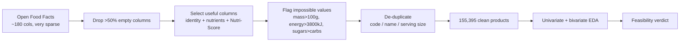
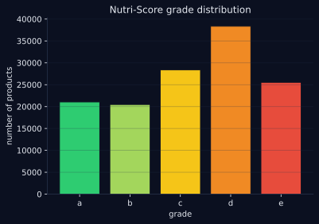
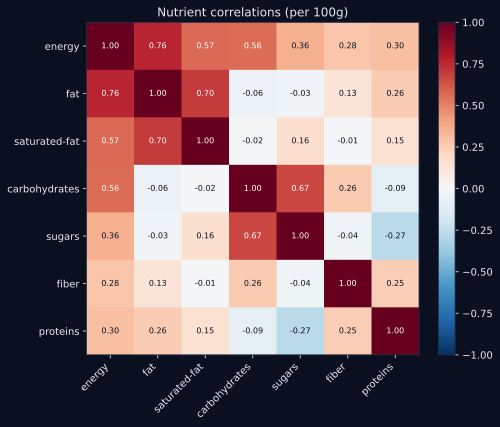
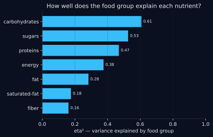

# 🥗 Open Food Facts — Data Cleaning & Public-Health EDA

[](https://github.com/boumbo85/p3-nutrition-openfoodfacts-eda/actions/workflows/ci.yml)
[](https://www.python.org/)
[](https://pandas.pydata.org/)


> Cleaning a large, messy open nutrition database (**Open Food Facts**) down to **155,395 usable products**, then an exploratory analysis to judge whether the data can support a public-health app that scores foods. Built in 2022, re-run in 2026 with the cleaning logic turned into tested, reusable code — including a cross-field check that catches **521 inconsistent rows the original pass missed**.

**Stack:** `pandas` · `numpy` · `matplotlib` · `seaborn` · `Python`  |  **Status:** completed  |  **Year:** 2022 · revisited 2026

> 🇫🇷 *Version française plus bas — [aller à la version FR](#-version-française).*

---

## 1. Context & Problem

A public-health agency wants to build an app that helps people pick healthier foods. Before any app, the question is **data feasibility**: Open Food Facts is a crowdsourced database with ~180 columns, most nearly empty, full of duplicates and impossible values (a chocolate bar logged with 900g of fat per 100g). Can it be cleaned into something trustworthy enough to score foods — and which fields actually carry signal?

## 2. Method & Tools

Pure data work, no model — and that's the point of P3. The approach:

- **Prune aggressively.** Drop columns more than 50% empty (most of the ~180), keep product identity + the per-100g nutrients + the Nutri-Score grade and food group.
- **Detect impossible values with physical bounds.** A per-100g mass nutrient can't exceed 100g; energy can't exceed ~3800 kJ (above pure fat); sugars can't exceed carbohydrates. These are data-entry errors, not foods.
- **Handle duplicates** by cross-checking code, name and serving size.
- **Univariate + bivariate analysis** on the clean data (distributions, Nutri-Score grades, nutrient correlations) to judge feasibility.

## 3. Pipeline / Schema



## 4. What Was Done

- Loaded the raw tab-separated Open Food Facts export, dropped columns >50% missing.
- Selected product identity + **7 per-100g nutrients** + `nutrition_grade_fr` + PNNS food group.
- Flagged and removed **physically impossible** nutrient values (bounds per 100g).
- Resolved duplicates via a code / name / serving-size logic.
- Ran **univariate** (distributions, grade counts) and **bivariate** (nutrient correlations) analysis.
- **2026 add:** turned the cleaning rules into tested functions, added a **sugars-vs-carbohydrates consistency check** the original notebook lacked, and ran **ANOVA / χ² tests with effect sizes** to move the group comparison from descriptive to inferential.

## 5. Results

**Clean dataset: 155,395 products × 17 columns.** Fill rate after cleaning:

| Column | Fill rate |
|---|--:|
| fiber_100g | 100.0% |
| carbohydrates_100g | 99.6% |
| energy_100g | 99.8% |
| fat_100g | 99.6% |
| proteins_100g | 99.4% |
| sugars_100g | 94.8% |
| saturated-fat_100g | 89.3% |
| nutrition_grade_fr | 86.1% |

**Nutri-Score distribution — the app's target variable exists and is usable:**



| Grade | a | b | c | d | e |
|---|--:|--:|--:|--:|--:|
| Products | 21,059 | 20,478 | 28,387 | **38,375** | 25,544 |

Grade **D is the most common** — the database skews toward processed foods, which matters if the app's baseline is "most products are mediocre".

**Nutrient correlations — the bivariate story:**



The correlations are nutritionally sensible, which is itself a data-quality signal: **energy ↔ fat 0.76** (fat is the most energy-dense macro), **saturated-fat ↔ fat 0.70**, **sugars ↔ carbohydrates 0.67** (sugars are a carb subset), and **sugars ↔ proteins −0.27** (sweet products tend to be low-protein). Nothing absurd → the cleaned data behaves like real food.

**The honest finding the 2026 re-run surfaces.** Two validation layers, two different outcomes:

- **Per-column bounds are clean** (`impossible_rows_remaining: 0`). The 2022 pass clipped every nutrient to its physical range (mass ≤ 100g/100g, energy ≤ 3800 kJ), so no single column holds an out-of-range value.
- **Cross-field consistency was never checked.** **521 products still have sugars > carbohydrates** — impossible, since sugars are a subset of carbohydrates. No single column is out of range, so column-by-column validation can't see it; only comparing the two fields reveals it. The new `sugar_consistency` function catches these rows.

The lesson: a dataset can pass every per-column check and still be internally inconsistent. The 521 rows are kept in the historical extract on purpose — flagged, not silently dropped, so the inconsistency stays visible and auditable (removing them is the first item in the TODO below).

**Do food groups actually drive nutrition? (2026 add — statistical tests)**

The descriptive analysis *suggests* that, say, beverages and fatty sauces differ in composition. Two tests ask whether that holds up — and, with n ≈ 27k, whether it's a *large* difference or just a significant one. Both run on the **26,870 products that carry a food group** (`pnns_groups_1`, placeholders excluded); the other ~83% are ungraded and sit outside this analysis.

- **One-way ANOVA — nutrient vs food group.** Every nutrient differs across groups (all p ≈ 0 — expected at this sample size). The number that matters is **η² (variance explained by the group)**:



| Nutrient | η² | F |
|---|--:|--:|
| carbohydrates | **0.69** | 5884 |
| energy | **0.62** | 4343 |
| sugars | **0.57** | 3499 |
| proteins | 0.48 | 2424 |
| fat | 0.40 | 1785 |
| saturated-fat | 0.27 | 955 |
| fiber | 0.20 | 687 |

The food group explains **~60-69% of the variance** in carbohydrates, energy and sugars — a strong effect: knowing the category tells you a lot about those nutrients. It explains far less for fibre (20%) and saturated fat (27%), which vary more *within* categories than between them.

- **Chi² — Nutri-Score grade vs food group.** The grade distribution depends on the food group (χ² = 16,326, dof = 40, p ≈ 0), with **Cramér's V = 0.40** — a moderate association. Category matters for the grade, but it isn't destiny: there are good and bad products in most groups.

Tests are implemented in plain numpy/pandas (F and χ² tail probabilities included), so the repo stays scipy-free and the stats stay transparent.

## 6. Impact

- Turns a **sparse, error-ridden dump into 155k usable products** with >99% fill on the core nutrients — the foundation any food-scoring app needs.
- Confirms **feasibility**: the Nutri-Score target exists (86% filled) and nutrients correlate sensibly, so a scoring app is buildable on this data.
- Flags a **residual data-quality issue** (521 inconsistent rows) with a reusable check — the difference between "looks clean" and "is clean".

> Academic project on public data, so the impact is methodological: a reproducible cleaning pipeline and an honest feasibility verdict.

## 7. Interpretation

P3 is a cleaning project, and the real lesson is that **cleaning is never done by eyeballing one column at a time**. Row-level bounds catch the obvious errors; the 521 sugars-over-carbs rows only appear when you check fields *against each other*. The sensible correlation structure is the reward — it's the evidence the data is trustworthy enough to build on.

## 8. Conclusion

A reproducible cleaning pipeline that yields 155k trustworthy products from a notoriously messy source, a clear feasibility verdict for a food-scoring app, and a cross-field check that exposes inconsistencies single-column validation hides.

## 9. Limits & Critical Review

- **`fiber_100g` is 100% filled** — suspicious; likely imputed with 0 rather than truly present, which would bias any fibre-based analysis.
- **521 sugars > carbs rows remain** — detected now, not yet dropped in the historical extract.
- **Nutri-Score is 14% missing** — an app would need a fallback for ungraded products.
- **The statistical tests cover only 17% of products** — the 26,870 with a food group. The ANOVA/χ² conclusions don't generalise to the ungraded majority, which may differ systematically.
- Crowdsourced data skews toward **processed, branded products**; not representative of all foods.

## 10. Improvements & TODO Next

- [ ] Drop/repair the 521 sugars > carbs rows and re-audit cross-field consistency.
- [ ] Distinguish true zeros from imputed zeros in `fiber_100g`.
- [x] ~~Add ANOVA / χ² tests for nutrient differences across PNNS food groups.~~ **Done** (2026) — with eta² / Cramér's V effect sizes.
- [ ] Post-hoc pairwise tests (e.g. Tukey HSD) to say *which* food groups differ, not just that they do.
- [ ] Impute or model missing Nutri-Score grades from the nutrients.
- [ ] Re-run on the latest Open Food Facts dump (the database has grown a lot since 2022).

---

## 🗂️ Repository structure

```
p3-nutrition-openfoodfacts-eda/
├── README.md
├── requirements.txt
├── requirements-dev.txt
├── pyproject.toml                # ruff + pytest config
├── LICENSE                       # MIT
├── .gitignore
├── .github/workflows/ci.yml      # lint (ruff) + tests (pytest)
├── results.json                  # all numbers in this README, reproducible
├── src/
│   ├── eda.py                    # pure, unit-tested cleaning + checks + ANOVA/χ² (no scipy)
│   └── run_eda.py                # reproducible EDA → dark SVG figures + results.json
├── tests/
│   └── test_eda.py               # pytest — cleaning + stats, no CSV needed
├── notebooks/
│   ├── 01_cleaning.ipynb                      # column pruning, impossible values, dedup
│   └── 02_univariate_bivariate_analysis.ipynb # distributions, grades, correlations
├── data/
│   └── README.md                 # dataset source + license (not versioned)
└── docs/
    ├── figures/                  # charts used in this README (regenerated)
    └── presentation.pdf          # project defense slides
```

The notebooks are the 2022 exploratory version; `src/run_eda.py` is the 2026
clean, reproducible pipeline that regenerates every number and figure here. The
cleaning rules in `src/eda.py` are unit-tested in CI without the dataset.

## 📦 Data

**[Open Food Facts](https://world.openfoodfacts.org/data)** — a collaborative, free food products database.

> **License — [Open Database License (ODbL) 1.0](https://opendatacommons.org/licenses/odbl/1-0/).**
> The database contents are available under ODbL; individual contents under the
> Database Contents License. Free to use and share with attribution and
> share-alike. The raw export (~several GB) and the cleaned extract are **not**
> versioned here — see [`data/README.md`](data/README.md).

## ▶️ Reproduce

```bash
python -m venv .venv && source .venv/bin/activate
pip install -r requirements.txt
# place the cleaned extract in data/ — see data/README.md
python src/run_eda.py --data data/clean_df_col_nrj7.csv --out docs/figures --results results.json
```

## 🧪 Dev / tests

```bash
pip install -r requirements-dev.txt
ruff check .      # lint
pytest -q         # unit tests on the pure cleaning logic (no dataset needed)
```

---

# 🇫🇷 Version française

## 1. Contexte & Problème

Une agence de santé publique veut une app qui aide à choisir des aliments plus sains. Avant l'app, la question est la **faisabilité des données** : Open Food Facts est une base collaborative aux ~180 colonnes, la plupart presque vides, pleine de doublons et de valeurs impossibles (une barre chocolatée à 900g de lipides pour 100g). Peut-on la nettoyer assez pour scorer des aliments — et quels champs portent vraiment du signal ?

## 2. Méthode & Outils

Du pur travail de données, sans modèle — c'est tout l'objet du P3 :

- **Élaguer franchement.** Retirer les colonnes >50% vides (la plupart des ~180), garder l'identité produit + les nutriments pour 100g + le grade Nutri-Score et le groupe alimentaire.
- **Détecter les valeurs impossibles par bornes physiques.** Un nutriment en masse pour 100g ne peut dépasser 100g ; l'énergie ne peut dépasser ~3800 kJ (au-delà du gras pur) ; les sucres ne peuvent dépasser les glucides. Ce sont des erreurs de saisie, pas des aliments.
- **Traiter les doublons** par recoupement code / nom / taille de portion.
- **Analyse univariée + bivariée** sur les données propres (distributions, grades, corrélations) pour juger la faisabilité.

## 3. Pipeline / Schéma

Voir le diagramme Mermaid ci-dessus (OFF ~180 cols → retrait >50% vides → sélection → valeurs impossibles → dédoublonnage → 155 395 produits propres → EDA → verdict de faisabilité).

## 4. Ce qui a été fait

- Chargement de l'export OFF (tab-separated), retrait des colonnes >50% manquantes.
- Sélection de l'identité produit + **7 nutriments pour 100g** + `nutrition_grade_fr` + groupe PNNS.
- Repérage et retrait des valeurs nutritionnelles **physiquement impossibles** (bornes pour 100g).
- Résolution des doublons par logique code / nom / portion.
- Analyse **univariée** (distributions, grades) et **bivariée** (corrélations entre nutriments).
- **Ajout 2026 :** règles de nettoyage transformées en fonctions testées, **vérification sucres-vs-glucides** absente du notebook d'origine, et **tests ANOVA / χ² avec tailles d'effet** pour passer la comparaison de groupes du descriptif à l'inférentiel.

## 5. Résultats

**Jeu propre : 155 395 produits × 17 colonnes.** Taux de remplissage après nettoyage :

| Colonne | Remplissage |
|---|--:|
| fiber_100g | 100,0 % |
| carbohydrates_100g | 99,6 % |
| energy_100g | 99,8 % |
| fat_100g | 99,6 % |
| proteins_100g | 99,4 % |
| sugars_100g | 94,8 % |
| saturated-fat_100g | 89,3 % |
| nutrition_grade_fr | 86,1 % |

**Distribution Nutri-Score — la variable cible de l'app existe et est exploitable :**


| Grade | a | b | c | d | e |
|---|--:|--:|--:|--:|--:|
| Produits | 21 059 | 20 478 | 28 387 | **38 375** | 25 544 |

Le grade **D domine** — la base penche vers les produits transformés, ce qui compte si la référence de l'app est « la plupart des produits sont médiocres ».

**Corrélations entre nutriments — l'histoire bivariée :**


Les corrélations sont nutritionnellement cohérentes, ce qui est en soi un signal de qualité : **énergie ↔ lipides 0,76** (le gras est le macro le plus énergétique), **gras saturés ↔ lipides 0,70**, **sucres ↔ glucides 0,67** (les sucres sont un sous-ensemble des glucides), et **sucres ↔ protéines −0,27** (les produits sucrés sont pauvres en protéines). Rien d'absurde → les données propres se comportent comme de vrais aliments.

**Le constat honnête que révèle la reprise 2026.** Deux couches de validation, deux résultats différents :

- **Les bornes par colonne sont propres** (`impossible_rows_remaining: 0`). Le nettoyage 2022 a ramené chaque nutriment dans sa plage physique (masse ≤ 100g/100g, énergie ≤ 3800 kJ) : aucune colonne prise seule ne contient de valeur hors borne.
- **La cohérence croisée n'avait jamais été vérifiée.** **521 produits ont encore sucres > glucides** — impossible, les sucres étant un sous-ensemble des glucides. Aucune colonne n'est hors borne, donc la validation colonne par colonne ne peut pas le voir ; seul le croisement des deux champs le révèle. La nouvelle fonction `sugar_consistency` capture ces lignes.

La leçon : un jeu de données peut passer tous les contrôles par colonne et rester incohérent en interne. Les 521 lignes sont **gardées volontairement** dans l'extrait historique — signalées, pas supprimées en silence, pour que l'incohérence reste visible et auditable (leur retrait est le premier point de la TODO plus bas).

**Le groupe alimentaire explique-t-il vraiment la composition ? (ajout 2026 — tests statistiques)**

L'analyse descriptive *suggère* que, disons, boissons et sauces grasses diffèrent en composition. Deux tests vérifient si ça tient — et, avec n ≈ 27k, s'il s'agit d'un *grand* écart ou seulement d'un écart significatif. Les deux tournent sur les **26 870 produits qui portent un groupe alimentaire** (`pnns_groups_1`, placeholders exclus) ; les ~83% restants sont non renseignés et sortent de cette analyse.

- **ANOVA one-way — nutriment vs groupe alimentaire.** Chaque nutriment diffère entre groupes (tous p ≈ 0 — attendu à cette taille d'échantillon). Le chiffre qui compte est **η² (part de variance expliquée par le groupe)** :


| Nutriment | η² | F |
|---|--:|--:|
| glucides | **0,69** | 5884 |
| énergie | **0,62** | 4343 |
| sucres | **0,57** | 3499 |
| protéines | 0,48 | 2424 |
| lipides | 0,40 | 1785 |
| gras saturés | 0,27 | 955 |
| fibres | 0,20 | 687 |

Le groupe alimentaire explique **~60-69 % de la variance** des glucides, de l'énergie et des sucres — un effet fort : connaître la catégorie en dit long sur ces nutriments. Il explique beaucoup moins pour les fibres (20 %) et les gras saturés (27 %), qui varient plus *à l'intérieur* des catégories qu'entre elles.

- **χ² — grade Nutri-Score vs groupe alimentaire.** La distribution des grades dépend du groupe (χ² = 16 326, ddl = 40, p ≈ 0), avec un **V de Cramér = 0,40** — association modérée. La catégorie compte pour le grade, mais ne fait pas tout : la plupart des groupes contiennent de bons et de mauvais produits.

Les tests sont implémentés en numpy/pandas pur (probabilités de queue F et χ² comprises) : le repo reste sans dépendance scipy et les stats restent transparentes.

## 6. Impact

- Transforme un **dump épars et truffé d'erreurs en 155k produits exploitables** avec >99 % de remplissage sur les nutriments clés — la base nécessaire à toute app de scoring.
- Confirme la **faisabilité** : la cible Nutri-Score existe (86 % remplie) et les nutriments corrèlent sainement, donc l'app est constructible sur ces données.
- Signale un **problème résiduel de qualité** (521 lignes incohérentes) via une vérification réutilisable — la différence entre « a l'air propre » et « est propre ».

> Projet académique sur données publiques : impact méthodologique (pipeline de nettoyage reproductible + verdict de faisabilité honnête).

## 7. Interprétation

Le P3 est un projet de nettoyage, et la vraie leçon est qu'**on ne nettoie jamais en regardant une colonne à la fois**. Les bornes par ligne attrapent les erreurs évidentes ; les 521 lignes sucres>glucides n'apparaissent qu'en croisant les champs *entre eux*. La structure de corrélation cohérente est la récompense — la preuve que les données sont fiables pour bâtir dessus.

## 8. Conclusion

Un pipeline de nettoyage reproductible qui tire 155k produits fiables d'une source réputée sale, un verdict de faisabilité clair pour une app de scoring, et une vérification croisée qui expose des incohérences que la validation colonne par colonne masque.

## 9. Limites & Regard critique

- **`fiber_100g` est rempli à 100 %** — suspect ; sans doute imputé à 0 plutôt que réellement présent, ce qui biaiserait toute analyse sur les fibres.
- **521 lignes sucres > glucides subsistent** — détectées désormais, pas encore retirées de l'extrait historique.
- **Nutri-Score manquant à 14 %** — une app aurait besoin d'un plan B pour les produits non gradés.
- **Les tests statistiques ne couvrent que 17 % des produits** — les 26 870 ayant un groupe alimentaire. Les conclusions ANOVA/χ² ne se généralisent pas à la majorité non renseignée, qui peut différer systématiquement.
- Données collaboratives biaisées vers les **produits transformés et de marque** ; pas représentatives de tous les aliments.

## 10. Améliorations & TODO Next

- [ ] Retirer/réparer les 521 lignes sucres > glucides et ré-auditer la cohérence croisée.
- [ ] Distinguer les vrais zéros des zéros imputés dans `fiber_100g`.
- [x] ~~Ajouter des tests ANOVA / χ² sur les nutriments par groupe PNNS.~~ **Fait** (2026) — avec tailles d'effet η² / V de Cramér.
- [ ] Tests post-hoc par paires (ex. Tukey HSD) pour dire *quels* groupes diffèrent, pas seulement qu'ils diffèrent.
- [ ] Imputer ou modéliser les grades Nutri-Score manquants à partir des nutriments.
- [ ] Rejouer sur le dernier dump Open Food Facts (la base a beaucoup grossi depuis 2022).

---

<sub>Built under <b>AnastatsIA</b> · OpenClassrooms Data Scientist — Project 3 · standardized project format</sub>
